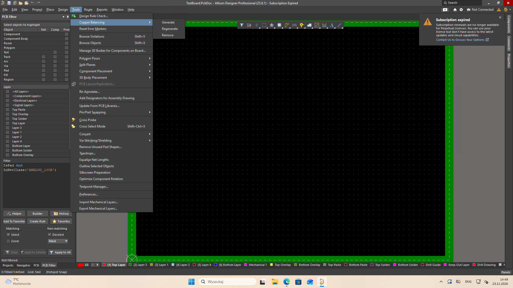
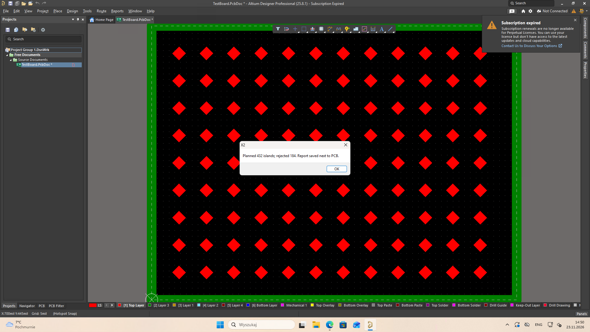

# Altium Copper Balancing

An experimental DelphiScript tool for adding no-net copper islands in Altium Designer, inspired by copper thieving in Siemens Xpedition.

**Download:** [Windows installer ZIP](https://github.com/codex-hil/altium-copper-balancing/releases/latest). Extract the entire archive, then run `Install.cmd`.

Adds **Tools → Copper Balancing → Generate / Regenerate / Remove** to the PCB Editor. Uses native Solid Regions and Altium user menu resources; no DLL, binary patch, or external service.



## What it does

- Diamond, square, and hexagonal patterns; configurable pitch, size, spacing, clearance, and grid origin.
- Layer selection from the active stack: all positive copper layers selected initially; negative internal planes shown but disabled.
- Whole rectangular board or a selected, unrotated Mechanical 1 rectangular Fill as the area limit.
- Full islands only, using integer Altium coordinates and conservative obstacle bounding boxes.
- Existing polygons, regions, tracks, pads, vias, keepouts, and cutouts remain obstacles. The tool does not repour or remove existing polygons.
- Explicit HV net-name exclusions with a user-specified distance. These are geometric exclusions, **not insulation qualification**.
- Preview statistics through **Dry run**; ownership-checked regeneration and removal.

This is a laboratory release, not a complete Xpedition replacement or a copper-density optimizer. It does not measure or equalize copper density across windows or layers.

## Compatibility and important limits

**Native-tested:** Altium Designer **25.8.1.18**, Windows 11, Windows PowerShell 5.1. The installer accepts version 25.8.1 and refuses other versions. Other machines and versions have not been qualified.

**Supported automatic outline:** a four-corner, axis-aligned rectangle. Curved, concave, arbitrary, and rigid-flex outlines are refused. Existing obstacle boxes are combined across layers, which can reject usable space. There is a 30,000-object/candidate safety budget.

**Copy-only guard:** save your test PCB in a folder whose path contains the literal text `copper-balancing-20261122`. The installer prepares such a directory automatically. This intentional guard remains in this public release. Do not remove it merely to run on a production design.

The Kasli SoC demonstration used a separate, task-specific plan inside an inscribed rectangle. It is not evidence that this general menu generator supports arbitrary board outlines. That design and its special scripts are not bundled here.

## Install

1. Run Altium once to create its user profile. Save your work and close Designer.
2. Download the release ZIP and **extract all files together**.
3. Double-click **Install.cmd**. If several registered installations exist, select the intended one.
4. Setup detects the executable and profile, verifies compatibility and payload hashes, backs up the affected files, installs the scripts, and inserts its own menu block into the user's `DXP.RCS`.
5. Accept the offer to launch Altium with the separate test PCB. In the PCB Editor, open **Tools → Copper Balancing → Generate**.

No administrator privileges, Python, Altium Monkey, VPN, or internet connection are needed to install or run the tool. Altium itself and a suitable license are required. A few installer prompts are in Polish in this preserved, native-tested package; the generator dialog is in English. **Tak/Yes** launches the test board.

The installer is unsigned. Windows or corporate policy may block it. Its launcher uses a process-local execution-policy override; it does not change the system policy or terminate Designer.

Default files:

```text
%LOCALAPPDATA%\CopperBalancing\Altium Designer <GUID>\
  source\CopperBalancing.PrjScr
  source\CopperBalancing.pas
  install-state.json
  backups\<unique timestamp>\
  copper-balancing-20261122\TestBoard.PcbDoc
```

Only an owned block is added to `%APPDATA%\Altium\Altium Designer {GUID}\DXP.RCS`. Program Files and the rest of the profile are not replaced.

## Use

1. Make a saved PCB copy under a directory containing `copper-balancing-20261122`, or start with the supplied test board.
2. Open **Generate**, choose the positive copper layers and pattern, then set dimensions and clearances. Pitch must be at least bounding dimension plus minimum island spacing.
3. Use **Dry run** to review statistics, then open Generate again to apply. Dialog values and layer choices reset each time.
4. Save, run native DRC, and inspect the result and manufacturing outputs. The script does **not** resolve the PCB rule hierarchy into its clearance field; choose sufficient distances and verify them against your rules.
5. Use **Regenerate** after layout changes, or **Remove** to delete only unchanged, verified generator-owned objects.

Keep `YourBoard.PcbDoc.cbal-manifest` beside the PCB, including when copying or renaming files. Persistent region names plus geometry fingerprints provide ownership; **native named unions are not implemented**. Regions can be selected and deleted through the standard PCB interface. Missing manifests or edited owned objects cause refusal rather than guessing ownership. Existing user unions are not used or modified.

No-net islands may generate **dead copper / unrouted** violations. Do not suppress unrelated rules to obtain a green result. Check whether a DRC report stopped at its violation limit. Ordinary clearance DRC is not a substitute for creepage, HV insulation, SI/PI, EMI, or fabrication review.



## Update, uninstall, and recovery

Save work and close Designer, then rerun `Install.cmd` to update, or run `Uninstall.cmd` to remove the owned menu and unchanged installed source files. Previous source files are restored if they existed before installation. Boards, manifests, reports, and backups remain.

Keep `install-state.json` and `backups`: they are required for safe ownership and recovery. Local edits to installed source or the owned menu cause refusal. Uninstall preserves later unrelated profile edits; it does not restore an entire old profile. If Altium rewrites resources or ownership state is lost, preserve current files and review the affected `DXP.RCS` backup manually while Designer is closed.

## Validation

The installed menu was demonstrated on a fresh native application start. Generate created **432** no-net diamonds on four positive layers, Regenerate replaced them with **108** on one selected internal layer, and Remove deleted those 108. Negative planes received no islands. Seven isolated installer test groups exercised repeat installation, uninstall, Unicode, ownership refusal, integrity checks, and profile preservation.

See [validation and limits](docs/VALIDATION.md), [machine-readable native checks](evidence/native-verification.json), and the supplied native PCB snapshots. Historical square/hexagon, DRC, export, and save/reopen tests are described with their separate version scope. No production or HV signoff is claimed.

## Development

Runtime source: [`source/CopperBalancing.pas`](source/CopperBalancing.pas), script project: [`source/CopperBalancing.PrjScr`](source/CopperBalancing.PrjScr).

```sh
python3 tools/check_release.py
python3 tools/build_release.py
```

On Windows with the supported Altium installation, close Designer before running isolated installer tests:

```powershell
powershell.exe -NoProfile -ExecutionPolicy Bypass -File .\test-installer.ps1
```

The tests use temporary profiles but also require a registered supported executable at `C:\Program Files\Altium\AD24\X2.EXE`. They do not start Designer. The optional snapshot verifier requires `altium-monkey`; it is not a runtime or installer dependency. See [validation](docs/VALIDATION.md) for its pinned version and scope.

Command-line setup:

```powershell
powershell.exe -NoProfile -ExecutionPolicy Bypass -File .\install.ps1 -Action Check
powershell.exe -NoProfile -ExecutionPolicy Bypass -File .\install.ps1 -Action Install
powershell.exe -NoProfile -ExecutionPolicy Bypass -File .\install.ps1 -Action Uninstall
```

For multiple installations, pass `-AltiumExe "C:\Program Files\Altium\AD24\X2.EXE"`. Controlled tests can also specify `-ProfileDirectory` and `-Destination`.

## License

Original code, documentation, and the synthetic fixture are released under the [MIT License](LICENSE). Altium Designer is proprietary and is not included. Altium and Xpedition are trademarks of their respective owners; this project is independent and is not endorsed by either vendor.
